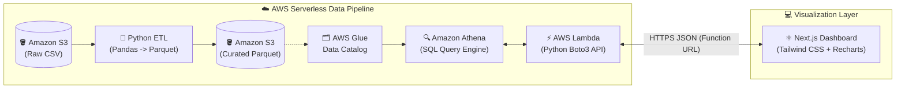

ร่าง `README.md` ที่คุณเขียนมา **ใช้ได้เลยครับ!** จุดเริ่มต้นดีมาก มีทั้งคำอธิบายภาพรวมโปรเจกต์ ระบุขนาดข้อมูล (**2,622 รายการ / 30 หมวดหมู่**), ลิงก์ Live Dashboard บน Vercel และแผนภาพ Mermaid Architecture ชัดเจนดีครับ

อย่างไรก็ตาม ตอนนี้ด้านล่างยังมีข้อความมาตรฐานของ `create-next-app` (`This is a Next.js project bootstrapped with...`) ติดอยู่ ซึ่งทำให้ดูเหมือนเทมเพลตเริ่มต้นมากกว่าจะเป็นโปรเจกต์ Data Engineering แบบเต็มตัว

แนะนำให้ปรับแต่งอีกนิดหน่อยเพื่อยกระดับ `README.md` ให้พร้อมใส่ Portfolio แบบมืออาชีพครับ:

1. **ลบข้อความ Default ของ Next.js ออก** แล้วแทนที่ด้วยสรุปฟีเจอร์และ Tech Stack ของโปรเจกต์เรา
2. **เพิ่มตาราง Tech Stack & Key Highlights** เพื่อเน้นทักษะ Data Engineering (เช่น แปลง CSV เป็น Parquet, ตั้งค่า CORS บน Lambda Function URL, ดึงข้อมูลสดผ่าน Athena)
3. **อัปเดตพาธไฟล์ให้ตรงกับโครงสร้างจริง** (`src/app/page.tsx` แทนที่จะเป็น `app/page.tsx`)

---

### ✨ เวอร์ชัน `README.md` ที่ขัดเกลาแล้ว (พร้อมนำไปวางแทนได้เลย)

```markdown
# End-to-End AWS Serverless Data Pipeline

An end-to-end serverless data engineering pipeline and real-time analytics dashboard built on **AWS (S3, Glue Data Catalog, Athena, Lambda)** and **Next.js**. This project ingests, transforms, and analyzes **2,622 Shopee Health & Wellness products across 30 categories** to uncover market pricing trends and category distributions.

🔗 **Live Dashboard:** [https://shopee-aws-data-pipeline-dashboard.vercel.app](https://shopee-aws-data-pipeline-dashboard.vercel.app)

---

## 🏗️ System Architecture



---

## 🚀 Key Features & Engineering Highlights

* **Data Lake & Columnar Storage:** Stored raw CSV data in Amazon S3 and transformed it via Python ETL into **Apache Parquet** format to reduce scan volume and query costs.
* **Serverless SQL Analytics:** Cataloged curated data in **AWS Glue Data Catalog** and queried aggregations (`COUNT`, `AVG`, `MIN`, `MAX` by category) using **Amazon Athena**.
* **Serverless REST API:** Built a Python (`boto3`) **AWS Lambda** function exposed via **Lambda Function URL** with CORS enabled to return structured JSON to the frontend.
* **Interactive Analytics Dashboard:** Built with **Next.js (App Router)**, **Tailwind CSS**, and **Recharts** to display KPI summary cards, Top 10 category charts, and searchable product listings.

---

## 🛠️ Tech Stack

| Layer | Technologies |
| --- | --- |
| **Storage & ETL** | Amazon S3, Python, Pandas, Apache Parquet |
| **Catalog & Query** | AWS Glue Data Catalog, Amazon Athena (SQL) |
| **Backend API** | AWS Lambda (Python, `boto3`), Lambda Function URL |
| **Frontend & Hosting** | Next.js, TypeScript, Tailwind CSS, Recharts, Vercel |

---

## 💻 Local Development

1. Clone the repository:
```bash
git clone [https://github.com/hilmanyusoh/shopee-aws-data-pipeline-dashboard.git](https://github.com/hilmanyusoh/shopee-aws-data-pipeline-dashboard.git)
cd shopee-aws-data-pipeline-dashboard

```


2. Install dependencies:
```bash
npm install

```


3. Configure your Lambda Function URL in `src/app/page.tsx`, then start the development server:
```bash
npm run dev

```


4. Open [http://localhost:3000](http://localhost:3000) in your browser.

```


```
